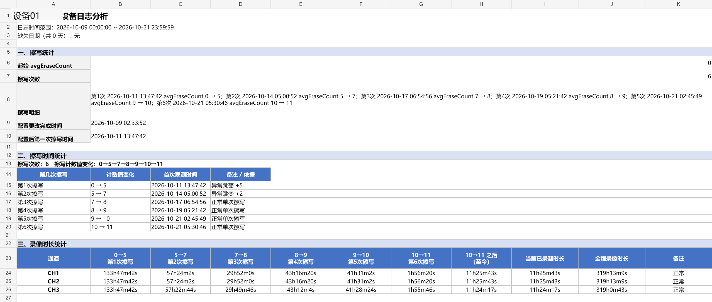
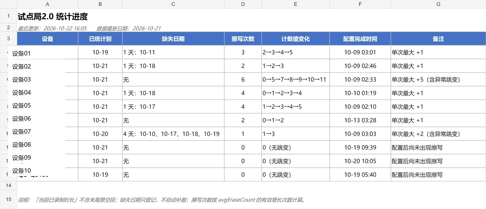

# 设备日志分析工具

[](https://github.com/linbode/device-log-analyzer/actions/workflows/ci.yml)

**把车载终端日志自动整理成一份可以核对的 Excel 报告。**

这个工具解决的问题很直接：

> 以前每来一批设备日志，都要人工翻日志、对时间、算录像时长、数擦写次数、填 Excel。  
> 现在把日志放到指定目录，修改一份配置，运行一条命令，就能生成报告。

它面向真实工作中的重复流程，不是演示脚本，也不是一次性的作业代码。

## 一分钟了解

| 问题 | 答案 |
|---|---|
| 它做什么？ | 把设备日志自动整理成 Excel 统计报告 |
| 为什么做？ | 人工翻日志太慢，旧脚本复制太多、难以维护 |
| 怎么使用？ | 修改配置，然后执行一条命令 |
| 怎么证明正确？ | 用现有报告做金标准，对 10 台设备逐项回归 |
| 当前结果？ | 业务指标 0 差异；8 项公开测试通过，另有 1 项内部数据回归 |

## 先看结果

下面是工具实际生成的设备报告：



这份报告主要告诉使用者：

1. 这台设备统计了哪几天。
2. 存储擦写了多少次，每次从多少增加到多少。
3. 每次擦写之前录了多久。
4. 当前已经确认录制多久。
5. 每天有哪些录像时间段、有没有异常。

工具还会生成一张所有设备的总览表：



> 截图来自项目真实运行结果，设备名称已替换为“设备01～设备10”。

## 为什么需要这个工具

车载终端会持续录制视频，并把运行情况写进日志。我们需要判断：

> 在真实录像强度下，设备存储能承受多久？

判断方法不是只看“擦写了多少次”，而是要把两个数据对应起来：

```text
录像时长  +  存储擦写次数  →  存储寿命参考
```

原始日志并不适合人直接阅读，主要问题是：

- 日志很多，单批 10 台设备、几千个文件。
- 时间戳只有时分秒，没有日期。
- 日志会跨天，也可能整天缺失。
- 设备断电时，不一定每一路摄像头都正常写“录像关闭”。
- 设备时钟可能回退或被重新设置。
- 擦写计数只增不减，而且采样值可能异常回落。
- 每接一批新车，如果复制一套脚本，代码会越来越大、越来越难维护。

所以这个工具的价值不是“少点几下鼠标”，而是：

- 把人工口径变成可重复执行的程序。
- 把每条统计结果变成可以追溯的数据。
- 用旧报告做回归验证，证明新代码没有悄悄改变结果。
- 下一次接新设备时，主要修改配置，不再复制分析脚本。

## 工具是怎么工作的

```text
操作日志目录或 ZIP
        ↓
识别设备、日期和原始日志行
        ↓
统一成“开机、录像开启、录像关闭、断电、擦写计数”等事件
        ↓
建立连续时间轴，处理跨天、回退和缺失日志
        ↓
计算录像段、擦写窗口、当前时长和全程时长
        ↓
生成设备 Excel、统计进度、JSON 结果和运行日志
```

用一句话概括：

```text
日志进去，统计逻辑在中间运行，Excel 和审计数据出来。
```

## 使用前要准备什么

### 1. Python 环境

需要 Python 3.11 或更高版本。

打开 PowerShell，进入项目目录：

```powershell
cd E:\codex_1\device-log-analyzer
```

安装依赖：

```powershell
python -m pip install -e .
```

如果电脑中已经安装 `openpyxl`，也可以直接运行：

```powershell
python analyze.py --help
```

### 2. 准备日志目录

推荐结构如下：

```text
2026-10-22日志/
├── 设备01/
│   └── 操作日志/
│       ├── 20261019000000_20261019235959_pf261019log
│       └── ...
├── 设备02/
│   └── 操作日志/
└── ...
```

工具支持：

- 已解压的操作日志；
- 无扩展名日志；
- `.log` 文件；
- 外层 ZIP；
- gzip 压缩日志。

原始日志不会被修改。

### 3. 修改配置

配置文件是普通文本文件。公开仓库中的 [`config/pilot2.toml`](config/pilot2.toml) 使用匿名设备名。实际使用时，建议复制模板生成本地配置：

```powershell
Copy-Item config\template.toml config\pilot2.local.toml
```

```text
config/pilot2.local.toml
```

可以用记事本或 VS Code 打开。它不是图形界面。

新增一台设备时，配置大概长这样：

```toml
[devices."device-01"]
display_name = "设备01"
folder = "device-01"
channels = ["CH1", "CH2", "CH3"]
start_recording = false
expected_start = "2026-10-22"
expected_end = "2026-10-31"
```

每个字段是什么意思：

| 字段 | 作用 |
|---|---|
| `display_name` | Excel 里显示的名称 |
| `folder` | 实际日志目录名 |
| `channels` | 这台设备有几路摄像头 |
| `start_recording` | 统计开始时是否已经在录像 |
| `expected_start` | 本批次应从哪一天开始 |
| `expected_end` | 本批次统计到哪一天 |

只改显示名称时，只修改 `display_name`。

## 具体怎么用

### 第一步：先检查一台设备

不要一开始就批量跑。先拿一台设备确认日志能读出来：

```powershell
python analyze.py inspect `
  --config config\pilot2.local.toml `
  --input "D:\测试日志\2026-10-22日志" `
  --device 设备01
```

输出会告诉你看：

- 读到了几条日志；
- 统计到哪一天；
- 擦写了多少次；
- 每次擦写的前后数值；
- CH1 当前录像时长和全程录像时长。

如果想看具体事件：

```powershell
python analyze.py inspect `
  --config config\pilot2.local.toml `
  --input "D:\测试日志\2026-10-22日志" `
  --device 设备01 `
  --events
```

### 第二步：生成全部设备报告

确认单台设备没问题后运行：

```powershell
python analyze.py analyze `
  --config config\pilot2.local.toml `
  --input "D:\测试日志\2026-10-22日志" `
  --output "output\2026-10-22"
```

生成的文件：

```text
output/2026-10-22/
├── 试点局报告.xlsx
├── 统计进度.xlsx
├── device_metrics.json
├── run_summary.json
└── run.log
```

| 文件 | 用途 |
|---|---|
| `试点局报告.xlsx` | 给业务看的主要报告 |
| `统计进度.xlsx` | 所有设备的总览 |
| `device_metrics.json` | 供程序、测试和审计使用 |
| `run_summary.json` | 本次运行的摘要 |
| `run.log` | 运行过程、警告和异常摘要 |

如果输出文件已经存在，程序会停止，防止误覆盖。确认要替换时增加：

```powershell
--force
```

### 第三步：和旧报告对比

替换旧工具之前，先用旧报告做一次回归：

```powershell
python analyze.py verify `
  --config config\pilot2.local.toml `
  --input "D:\测试日志\2026-10-22日志" `
  --baseline "D:\旧报告\试点局2.0报告.xlsx"
```

正常结果：

```text
PASS: 所有业务指标与基线一致。
```

如果有差异，程序会指出：

- 哪台设备；
- 哪个通道；
- 哪个擦写窗口；
- 旧值和新值分别是什么。

## 第一次使用建议顺序

对不熟悉代码的人，建议按下面顺序操作：

1. 先复制一份日志，不要直接使用唯一原始数据。
2. 打开 `config/template.toml`，照着填写设备信息。
3. 用 `inspect` 检查一台设备。
4. 用 `analyze` 生成报告。
5. 打开 Excel，核对第一台设备。
6. 用 `verify` 比较旧报告。
7. 确认无误后再处理整批设备。

## 这个工具如何判断结果是否正确

新实现没有拿旧报告当模板，也没有复制旧 Excel。

真实流程是：

```text
重新读取日志
  → 重新计算录像段
  → 重新计算擦写窗口
  → 生成新的 Excel
  → 最后才读取旧报告做比较
```

旧报告只承担一个作用：

> 当作“答案纸”，检查新工具算出来的业务结果是否与现有口径一致。

当前回归结果：

| 验证项 | 当前结果 |
|---|---|
| 设备数量 | 10 台 |
| 操作日志数量 | 83 个 |
| 三通道擦写窗口 | 全部一致 |
| 当前已录制时长 | 全部一致 |
| 全程录像时长 | 全部一致 |
| 业务指标差异 | **0** |
| 公开自动化测试 | **8 项通过** |
| 内部金标准回归 | **1 项**，需要内部日志和旧报告，公开环境默认跳过 |

## 我的开发路线

这个项目不是一次性写出来的，而是沿着真实问题逐步演进。

需要说明：当前公开仓库是**重构完成后的脱敏成品快照**，不是原始开发仓库。因为历史脚本、真实日志和截图曾包含内部设备信息，公开版本清理了 Git 历史，并重新提交为一个干净的初始版本。

因此，Git 提交时间只能说明公开快照的整理时间，不能单独证明几个月的开发过程。真实的 77 个早期脚本和迁移记录保存在本机 `legacy/private/`，不随公开仓库上传。这里如实说明边界，不用伪造提交日期制造“开发了很久”的假象。

### 阶段 1：先验证业务问题

一开始没有直接写“大项目”，而是先人工看日志，确认：

- 日志是什么格式；
- 录像开关事件如何出现；
- 擦写计数在哪里；
- 跨天和缺失日期如何处理；
- 设备异常时日志会缺什么。

这一步的目标是先把业务问题看懂，而不是先写代码。

### 阶段 2：写单台设备脚本

针对一台设备写最小脚本，完成：

- 日志读取；
- 录像开关匹配；
- 录像段计算；
- 擦写窗口统计；
- Excel 输出。

### 阶段 3：接更多设备后发现复用问题

新设备加入后，路径、日期、通道和异常行为各不相同。最开始采用复制脚本再修改的方式，结果出现了：

- 同一设备的多个版本；
- 重复函数；
- 路径写死；
- 修改一处后忘记同步其他脚本；
- 没有自动测试；
- 结果只能靠人眼检查。

这让我意识到，真正的问题不是“脚本不够多”，而是“没有统一的数据和规则入口”。

### 阶段 4：抽出统一分析流程

把散落在脚本里的处理拆成四部分：

```text
parser  读取日志
rules   处理时间和业务规则
metrics 计算统计结果
report  生成 Excel
```

同时增加：

- `models.py`：统一定义事件和结果；
- `config.py`：读取配置；
- `verification.py`：比较旧报告；
- `cli.py`：提供统一命令。

### 阶段 5：配置化

把设备目录、名称、通道、日期和特殊口径移到 TOML 配置。

目标是：

> 下一批设备主要是改配置，而不是复制一套 Python 脚本。

### 阶段 6：建立金标准回归

先用旧报告确认业务口径，再让新引擎独立计算。

比较内容不是 Excel 文件大小，而是：

- 每台设备；
- 每个通道；
- 每个擦写窗口；
- 当前已录制时长；
- 全程录像时长。

当前 10 台设备全部一致。

### 阶段 7：补测试、文档和可展示材料

- 为断电 5 秒、跨天、计数回落、悬空段等规则写测试；
- 旧脚本保存在本机 `legacy/private/`，公开仓库不包含真实设备脚本；
- 写 README、业务规则和回归说明；
- 从真实结果生成项目截图；
- 使用 Git 保存版本记录。

## 技术难点

这个项目并不是在日志中做简单的字符串查找。

### 时间只有时分秒

日期依靠文件名推断。一个日志文件可能跨天，日志也可能整日缺失，所以不能直接用时间字符串比较。

### 断电与显式关闭不一致

有些设备断电时不会给每一路摄像头写关闭事件。

工具采用：

- 5 秒内出现显式关闭：使用显式时间；
- 5 秒内没有显式关闭：使用断电时间 +5 秒；
- 日志结束时仍未关闭：标记悬空段。

### 擦写计数不是实时值

录像过程中 `avgEraseCount` 可能长时间不变化，重新开机后才一次性补记。

因此：

- 只有数值增加才计为擦写；
- 一次增加多个值，标记为异常跳变；
- 数值回落，标记为采样异常，不重复计算。

### 新代码必须和旧口径兼容

现有报告中存在少数设备专属规则。

例如：

- 设备03 第一次擦写前包含日志窗口之前的录像；
- 设备07 使用旧报告按天切分和低压处理口径。

这些行为通过设备配置显式保存，避免为了兼容一台设备而影响所有设备。

## 这个项目的技术组成

技术选择尽量简单：

- Python 3.11+
- Python 标准库
- `openpyxl` 生成 Excel
- TOML 保存配置
- `unittest` 做自动测试
- Git 管理版本

没有引入数据库、网页服务或数据分析框架，因为当前问题的核心是日志时间轴和状态判断，不是海量 SQL 查询。

## 项目目录

```text
device-log-analyzer/
├── analyze.py                    # 本地运行入口
├── config/
│   ├── pilot2.toml               # 匿名示例配置
│   ├── pilot2.local.toml         # 本机真实配置，不进入 Git
│   └── template.toml             # 新设备配置模板
├── src/device_log_analyzer/
│   ├── models.py                 # 数据模型
│   ├── parser.py                 # 日志解析
│   ├── rules.py                  # 时间轴和业务规则
│   ├── metrics.py                # 统计计算
│   ├── report.py                 # Excel 输出
│   ├── verification.py           # 金标准回归
│   └── cli.py                    # 命令行入口
├── tests/                        # 单元测试和真实数据回归
├── docs/                         # 规则、回归和截图
└── legacy/                       # 旧脚本说明；真实归档保存在 Git 忽略目录
```

## 开发检查

运行基础测试：

```powershell
python -m unittest discover -s tests -v
```

公开仓库默认运行结果应为：

```text
Ran 9 tests
OK (skipped=1)
```

这表示 **8 项公开测试通过，1 项内部金标准回归因缺少私有数据而跳过**。跳过不等于通过，不能把它算成公开可复现的 `9/9`。

GitHub Actions 会在全新的 Ubuntu 环境中依次安装 Python、安装项目依赖、
编译代码并运行这 8 项公开测试。CI 不读取任何内部日志或旧报告，
因此页面上的绿色检查可以由任何人打开运行记录核验。

运行真实数据金标准测试：

```powershell
$env:PILOT2_LOGS = "D:\测试日志\日志汇总2.0"
$env:PILOT2_BASELINE = "D:\旧报告\试点局2.0报告.xlsx"
$env:PILOT2_CONFIG = "config\pilot2.local.toml"
python -m unittest discover -s tests -v
```

## 第一版暂不包含

- 黑匣子二进制解析；
- 打印日志深度分析；
- 网页配置界面；
- 数据库；
- 为每台设备复制一份脚本。

如果新设备只是名称、目录、日期或阈值变化，只需要修改配置。  
如果日志格式发生结构性变化，才需要修改解析器。

## 进一步阅读

- 完整业务规则：[docs/RULES.md](docs/RULES.md)
- 金标准回归说明：[docs/REGRESSION.md](docs/REGRESSION.md)
- 开发过程与仓库说明：[docs/DEVELOPMENT.md](docs/DEVELOPMENT.md)
- 版本变化：[CHANGELOG.md](CHANGELOG.md)

